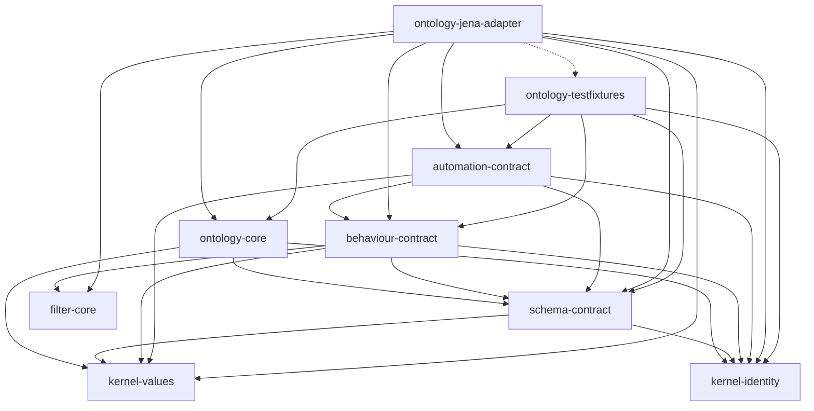
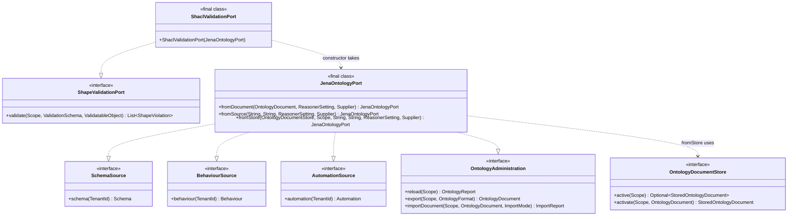

# Public contracts

This page describes the public contracts of this Maven repository.
Maven is the build tool that builds each module.
The page is for new engineers.
Each statement comes from the Java source in the repository.

## What an API and an SPI are

An API (application programming interface) is a set of Java types that callers use.
The `api` packages hold the API.
An SPI (service provider interface) is a set of Java interfaces that a provider implements.
The `spi` packages hold the SPI.
A JDK (Java Development Kit) is the toolkit that compiles and runs Java code.
This repository needs JDK 25.

In the tables, the Kind column has three values:

- `api`: a public type that callers use.
- `spi`: a public interface that a provider implements.
- `internal`: a type that callers must not use.

The words "public contract" mean the `api` and `spi` types.
Public types in the adapter and fixture modules have no `api` or `spi` package.
The tables mark them `api` and say so in the Purpose column.

Other terms in this page:

- OWL (Web Ontology Language) is a language that describes an ontology.
- RDF (Resource Description Framework) is a data model of subject, predicate, and object statements.
- Turtle is a text format that writes RDF.
- SHACL (Shapes Constraint Language) is a language that states rules for RDF data.
- Mermaid is a text language that draws diagrams.

## Module dependencies

Each edge comes from a `<dependency>` entry in the pom.xml of the module at the tail of the arrow.
`kernel-identity`, `kernel-values`, and `filter-core` are external to this repository.
The dashed arrow marks a test scope dependency.

## ontology-core SPI and administration

The diagram shows the SPI interfaces, `OntologyAdministration`, and `JenaOntologyPort`.
`SchemaSource`, `BehaviourSource`, and `AutomationSource` come from other contract modules.

## ontology-core

This module holds the ontology administration API and the document store SPI.
It depends on `schema-contract`.

| Type | Kind | Purpose | Key methods |
|---|---|---|---|
| `OntologyAdministration` | api | Interface that reloads, exports, and imports the ontology document. | `reload`, `export`, `importDocument` |
| `ShapeValidationPort` | api | Interface that checks one object against shape rules. | `validate(Scope, ValidationSchema, ValidatableObject)` |
| `ValidationSchema` | api | Interface that tells the validator about object kinds and datatypes. | `hasType`, `typeAndSupertypes`, `xsdDatatypeOf` |
| `ValidatableObject` | api | Record that holds an object identifier, its kind IRI, and its property values. | `id`, `typeIri`, `propertiesByIri` |
| `ShapeViolation` | api | Record that reports one failed shape rule for one property. | `propertyIri`, `message` |
| `OntologyDocument` | api | Record that holds the ontology text and its format. | `content`, `format` |
| `OntologyFormat` | api | Enum of document formats. It has one value: `TURTLE`. | `TURTLE` |
| `ImportMode` | api | Enum of import modes. It has one value: `REPLACE`. | `REPLACE` |
| `ImportReport` | api | Record that tells if an import was accepted. | `accepted`, `report`, `typeCount` |
| `OntologyReport` | api | Record that tells if the ontology is consistent and lists issues. | `consistent`, `issues`, `describe` |
| `OntologyIssue` | api | Record that describes one problem with a severity and a message. | `severity`, `subjectIri`, `message` |
| `Severity` | api | Enum of issue levels. | `ERROR`, `WARNING` |
| `OntologyException` | api | Final exception that carries an inconsistent report. It extends `NoConsistentOntologyException`. | `report` |
| `OntologyDocumentStore` | spi | Interface that stores ontology documents by scope. | `active(Scope)`, `activate(Scope, OntologyDocument)` |
| `StoredOntologyDocument` | spi | Record that holds a stored document with identifier, version, and time. | `id`, `version`, `document`, `createdAt` |

The package `org.sequeless.ontology.internal` has only a `package-info.java` file.
It has no types.

## schema-contract

This module describes the schema: object kinds, properties, and cardinality.

| Type | Kind | Purpose | Key methods |
|---|---|---|---|
| `Schema` | api | Record that holds the ontology version, IRI, prefixes, and object kinds. | `type(iri)`, `typeByName`, `names` |
| `TypeDefinition` | api | Record that defines one object kind with its super kinds and properties. | `iri`, `label`, `superTypes`, `properties` |
| `PropertyDefinition` | api | Sealed interface that permits `AttributeDefinition` and `RelationshipDefinition`. | `iri`, `label`, `cardinality`, `order` |
| `AttributeDefinition` | api | Record that implements `PropertyDefinition` for a value with a datatype. | `datatype` |
| `RelationshipDefinition` | api | Record that implements `PropertyDefinition` for a link to another object kind. | `targetTypeIri`, `inverseIri`, `transitive` |
| `Cardinality` | api | Record that holds a minimum and an optional maximum count. | `optional`, `required`, `exactly`, `atMost`, `range` |
| `Datatype` | api | Enum of the XSD datatypes that attributes use. | `xsdIri`, `fromXsd` |
| `DisplayHints` | api | Record that holds the order, group, and hidden flag. | `none` |
| `OntologyVersion` | api | Record that holds a version number of at least 1. | `value` |
| `AggregateFunction` | api | Enum of rollup functions. | `COUNT`, `SUM`, `MIN`, `MAX`, `AVG` |
| `SchemaSource` | spi | Interface that gives the schema for a tenant. | `schema(TenantId)` |
| `NoConsistentOntologyException` | spi | Runtime exception that a source throws when no consistent ontology exists. | `NoConsistentOntologyException(String)` |

## behaviour-contract

This module describes state machines and derivation rules.
It depends on `schema-contract`.

| Type | Kind | Purpose | Key methods |
|---|---|---|---|
| `Behaviour` | api | Record that holds state machines and derivations by IRI. | `stateMachine(typeIri)`, `derivation(propertyIri)` |
| `StateMachineDefinition` | api | Record that holds states, the initial state, and transitions. | `states`, `initialState`, `transitions` |
| `State` | api | Record that holds a state IRI, label, and display order. | `iri`, `label`, `displayOrder` |
| `Transition` | api | Record that moves one state to another with a trigger and optional guard. | `fromStateIri`, `toStateIri`, `trigger`, `guard` |
| `TriggerSpec` | api | Sealed interface for the four trigger records. | `kind` |
| `UserActionTrigger` | api | Record that implements `TriggerSpec` for a user action. | `kind` |
| `OnChangeTrigger` | api | Record that implements `TriggerSpec` for a change of watched properties. | `watchIris` |
| `TimerTrigger` | api | Record that implements `TriggerSpec` for a delay. | `after` |
| `ExternalSignalTrigger` | api | Record that implements `TriggerSpec` for a named external signal. | `signalName` |
| `TriggerKind` | api | Enum of trigger kinds. | `USER_ACTION`, `ON_CHANGE`, `TIMER`, `EXTERNAL_SIGNAL` |
| `DerivationRule` | api | Sealed interface that permits `RollupRule` and `PluginRule`. | `materialised` |
| `RollupRule` | api | Record that implements `DerivationRule` with an aggregate over related objects. | `sourceTypeIri`, `viaIri`, `function`, `criteria` |
| `PluginRule` | api | Record that implements `DerivationRule` with a named plugin. | `pluginName` |
| `BehaviourSource` | spi | Interface that gives the behaviour for a tenant. | `behaviour(TenantId)` |

## automation-contract

This module describes the actions that run on a transition.
It depends on `behaviour-contract` and `schema-contract`.

| Type | Kind | Purpose | Key methods |
|---|---|---|---|
| `Automation` | api | Record that maps each transition reference to a list of actions. | `actions(TransitionRef)` |
| `TransitionRef` | api | Record that names one transition by state machine, source state, and name. | `stateMachineIri`, `fromStateIri`, `transitionName` |
| `Action` | api | Sealed interface that permits four action records. | none |
| `SetPropertyAction` | api | Record that implements `Action` and sets a property to a value or expression. | `propertyIri`, `value`, `expression` |
| `CreateObjectAction` | api | Record that implements `Action` and creates an object. | `typeIri`, `properties` |
| `PropertyAssignment` | api | Record that holds one property value or expression for a new object. | `propertyIri`, `value`, `expression` |
| `WebhookAction` | api | Record that implements `Action` and calls a URL. | `url`, `method`, `body` |
| `LogAction` | api | Record that implements `Action` and writes a message. | `message` |
| `AutomationSource` | spi | Interface that gives the automation for a tenant. | `automation(TenantId)` |

## ontology-jena-adapter

This module implements the SPI with Apache Jena.
It depends on all four contract modules.
Its types have no `api` or `spi` package.
Public types here are marked `api`.

| Type | Kind | Purpose | Key methods |
|---|---|---|---|
| `JenaOntologyPort` | api | Final class that implements the three sources and `OntologyAdministration`. Public contract. | `fromDocument`, `fromSource`, `fromStore`, `schema`, `behaviour`, `automation`, `reload`, `export`, `importDocument` |
| `ShaclValidationPort` | api | Final class that implements `ShapeValidationPort` with SHACL. Public contract. | `ShaclValidationPort(JenaOntologyPort)`, `validate` |
| `ReasonerSetting` | api | Enum of reasoning levels. Public contract. | `OWL`, `RDFS`, `NONE`, `specification` |
| `JenaOntologySettings` | api | Record that holds a reasoner setting and a source location. Public contract. | `reasoner`, `source` |
| `OntologySource` | internal | Package-private class that opens an ontology document from a location. | `open` |
| `SchemaValidationSchema` | internal | Package-private class that implements `ValidationSchema` over a `Schema`. | `hasType`, `typeAndSupertypes`, `xsdDatatypeOf` |
| `ShaclDataGraphBuilder` | internal | Package-private class that builds an RDF graph for one object. | `build` |
| `SnapshotMapper` | internal | Public class in the `internal` package that maps a Jena model to schema and behaviour. | `map` |
| `ConsistencyChecker` | internal | Public class in the `internal` package that checks a model for consistency. | `check` |
| `OntModelBuilder` | internal | Public class in the `internal` package that builds a Jena model from Turtle. | `build` |
| `TurtleExporter` | internal | Public class in the `internal` package that writes a model as Turtle. | `export` |
| `ImportResolver` | internal | Public class in the `internal` package that resolves bundled meta ontologies. | none public except the IRI constant |
| `MappingResult` | internal | Public record in the `internal` package that holds the mapping output. | none |
| `SqVocabulary` | internal | Class in the `internal` package. It holds package-private vocabulary constants and one public method. | `rejectionMessageIfReserved(OntModel)` |
| `SqAnnotations` | internal | Package-private class in the `internal` package that reads annotations. | `bool`, `intValue`, `string` |

## ontology-testfixtures

This module gives test fixtures and contract test runners.
It depends on all four contract modules.
Its types have no `api` or `spi` package.
Public types here are marked `api`.

| Type | Kind | Purpose | Key methods |
|---|---|---|---|
| `Fixtures` | api | Final class with reference ontology documents and IRI constants. Public contract. | `defaultScope`, `referenceOntology`, `inconsistentOntology`, `inverseTransitiveOntology`, `referencePluginOntology` |
| `InMemoryOntologyPort` | api | Final class that implements the three sources and `OntologyAdministration` as a fake. | `schema`, `behaviour`, `automation`, `reload`, `export`, `importDocument` |
| `InMemoryOntologyDocumentStore` | api | Final class that implements `OntologyDocumentStore` in memory. | `active`, `activate` |
| `OntologyPorts` | api | Record that groups the four ports of one implementation. | `of(port)`, `schemaSource`, `behaviourSource`, `automationSource`, `administration` |
| `OntologyContract` | api | Abstract test runner. A provider extends it to check the ports. | `portFor(OntologyDocument)` |
| `OntologyDocumentStoreContract` | api | Abstract test runner. A provider extends it to check a document store. | `freshDocuments()` |

## Adding a contract change

A non-obvious contract decision needs a new decision record (`make new-adr title=...`).
See CONTRIBUTING.md for the steps to write one.

Run `make fmt` and `make verify` before you open a pull request.
The release-please tool generates the changelog entry from your commit messages.
